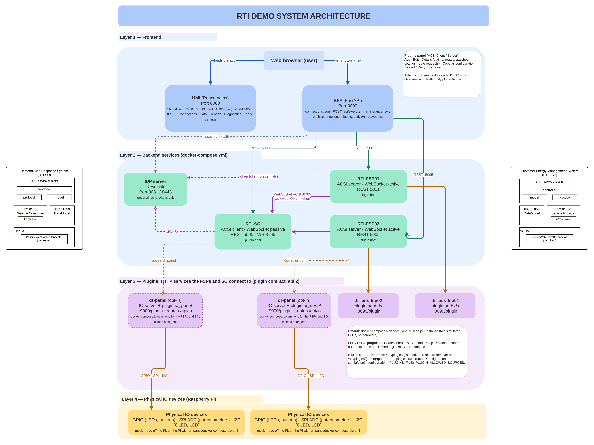
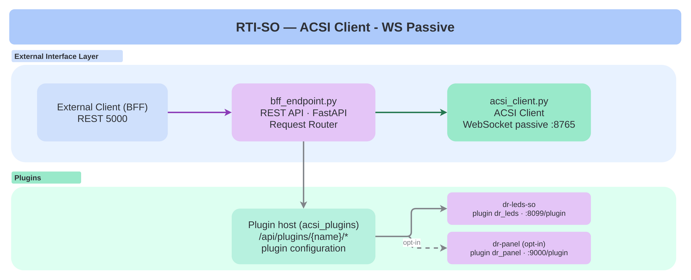
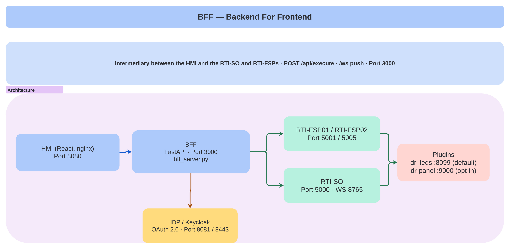
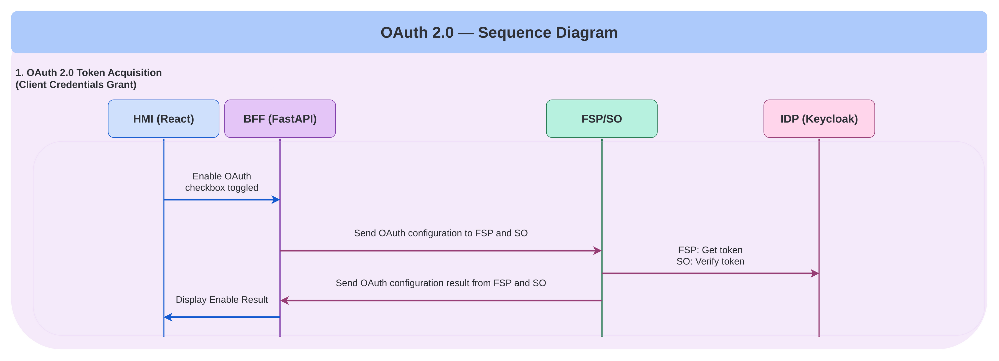
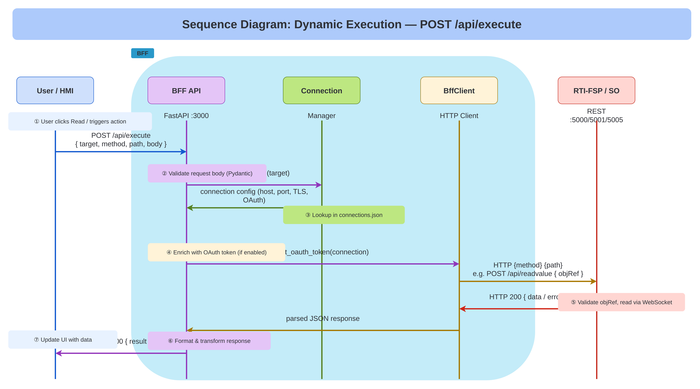

<!--
SPDX-FileCopyrightText: 2026 Netbeheer Nederland

SPDX-License-Identifier: Apache-2.0
-->

# RTI demo: system overview

The RTI demo is an IEC 61850-based Real-Time Infrastructure: an RTI-SO (system operator, ACSI client) and one or more
RTI-FSPs (flexibility service providers, ACSI servers) exchange ACSI services over WebSocket, managed through a BFF and
a React HMI. Plugins connect to the FSPs and SO: by default two simulated LEDs each (dr_leds), or a Raspberry Pi's
LEDs, buttons, potentiometers and displays (dr_panel).

This page is the system view: components, how they communicate, the data model, and the main flows. How to run each
part is in the module READMEs (see [Components](#components)); why it is built this way is in
[decisions/](decisions/README.md); changes not built yet are described in [specs/](specs/README.md); the HMI's
wireframes, style and the earlier designs are in [Design](#design).

## Components

| Component             | Type                                 | ACSI role   | Default port                                  |
|-----------------------|--------------------------------------|-------------|-----------------------------------------------|
| HMI                   | Frontend                             | -           | 8080                                          |
| BFF                   | Backend                              | -           | 3000                                          |
| RTI-FSP01, RTI-FSP02  | Service                              | ACSI server | 5001, 5005 (REST); WebSocket client of the SO |
| RTI-SO                | Service                              | ACSI client | 5000 (REST), 8765 (WebSocket server)          |
| dr_leds               | Plugin, one per FSP and SO (default) | -           | 8099                                          |
| dr_panel              | Plugin for the Raspberry Pi (opt-in) | -           | 9000                                          |
| IDP server (Keycloak) | Service                              | -           | 8081 (HTTP), 8443 (HTTPS)                     |



Each component's README is its reference: run and test commands, configuration, API, and design.

| Component                                                     | Reference                                                                       |
|---------------------------------------------------------------|---------------------------------------------------------------------------------|
| RTI-FSP (ACSI server, WebSocket active)                       | [modules/fsp/README.md](../../examples/rti-demo/modules/fsp/README.md)          |
| RTI-SO (ACSI client, WebSocket passive)                       | [modules/so/README.md](../../examples/rti-demo/modules/so/README.md)            |
| BFF (backend for frontend)                                    | [modules/bff/README.md](../../examples/rti-demo/modules/bff/README.md)          |
| HMI (React frontend)                                          | [modules/hmi/README.md](../../examples/rti-demo/modules/hmi/README.md)          |
| Plugins (HTTP services the FSP and SO connect to)             | [rti-plugins/README.md](../../examples/rti-plugins/README.md)                   |
| DR Leds (two simulated LEDs, the sample plugin)               | [rti-plugins/dr_leds/README.md](../../examples/rti-plugins/dr_leds/README.md)   |
| DR Panel (Raspberry Pi devices, its own stack)                | [rti-plugins/dr_panel/README.md](../../examples/rti-plugins/dr_panel/README.md) |
| Plugin host                                                   | [modules/plugins/README.md](../../examples/rti-demo/modules/plugins/README.md)  |
| Demo playbooks                                                | [playbooks/README.md](../../examples/rti-demo/playbooks/README.md)              |

### Inside the FSP, SO, and BFF

The FSP and SO each take REST calls from the BFF in `bff_endpoint.py`, run their side of ACSI over the WebSocket, and
host the plugins they connect to:




The BFF sits between the HMI and the instances:



The diagrams are pages of [design/RTI-demo-system-architecture.drawio](design/RTI-demo-system-architecture.drawio);
after a change, export the page again into [images/](images), for example
`drawio -x -f png -p 2 -s 2 -b 20 -o images/RTI_Demo_System_Architecture_Overview.png design/RTI-demo-system-architecture.drawio`
(`-p` counts pages from 1: 2 is the overview, 3 OAuth, 4 FSP, 5 SO, 6 BFF, 7 `/api/execute`).

## Communication

| From     | To               | Protocol                      | Port                             |
|----------|------------------|-------------------------------|----------------------------------|
| HMI      | BFF              | HTTP/REST                     | 3000                             |
| BFF      | FSP              | HTTP/REST                     | 5001 (FSP01), 5005 (FSP02)       |
| BFF      | SO               | HTTP/REST                     | 5000                             |
| FSP      | SO               | WebSocket (ACSI)              | 8765                             |
| FSP, SO  | plugins          | HTTP (plugin API)             | 8099 (dr_leds), 9000 (dr_panel)  |
| dr_panel | physical devices | direct hardware               | GPIO, SPI (ADC), I2C (OLED, LCD) |
| BFF      | IDP server       | discovery, health             | 8081 (HTTP) or 8443 (HTTPS)      |
| FSP      | IDP server       | OAuth 2.0 token request       | 8081 (HTTP) or 8443 (HTTPS)      |
| SO       | IDP server       | OAuth 2.0 signing keys (JWKS) | 8081 (HTTP) or 8443 (HTTPS)      |

All REST traffic is `application/json`.

### WebSocket (ACSI)

- The IEC 61850 ACSI protocol: read, write, control, reports, status.
- The FSP is the WebSocket client (active) and the ACSI server; the SO is the WebSocket server (passive, port 8765)
  and the ACSI client.
- The FSP connects to the SO: FSP (ACSI server, WebSocket client) → SO (ACSI client, WebSocket server, port 8765).

### OAuth 2.0

- IDP server: Keycloak, on 8081 (HTTP) or 8443 (HTTPS); see `scripts/keycloak`. For HTTPS, Keycloak uses
  `testing/certs/keycloak.pem`, which covers `keycloak`, `localhost` and `127.0.0.1`; set the connection's
  `auth_server_ca` to the CA certificate (`ca.pem`), which the FSP and SO use to verify it. The BFF's discovery and
  health calls don't verify the certificate.
- Flow: the FSP requests a token from the IDP (client credentials) and sends it when it connects to the SO; the SO
  checks it against the IDP's signing keys (JWKS) and token issuer.
- Settings: entered in the HMI, stored per connection in the BFF's `connections.json`; the BFF adds them to the calls
  it forwards to the FSP and SO.
- Fields: `enable_oauth`, `idp_server`, `realm`, `token_endpoint`, `certificate_endpoint`, `token_issuer`,
  `client_id`, `client_secret`, `auth_server_ca`, `enable_token_refresh`.



### TLS

- Versions: TLSv1.2 and TLSv1.3.
- Passive mode (server, the SO): `server_key` and `server_cert`.
- Active mode (client, the FSP): `server_ca`, the CA certificate.
- Configured per connection in `connections.json`.

## IEC 61850 data model

### Hierarchy

```
Substation
+-- Logical Device (LD)
    +-- Logical Node (LLN0, LPHD, MMXU, etc.)
        +-- Data Object (Mod, Beh, NamPlt, etc.)
            +-- Data Attribute (stVal, q, t, etc.)
```

### Example

`LD0/LLN0$ST$Mod`

- `LD0`: Logical Device 0
- `LLN0`: Logical Node Zero
- `ST`: functional constraint (status information)
- `Mod`: Mode (data object)

### Data types

| Type         | Values             |
|--------------|--------------------|
| BOOLEAN      | ON/OFF, True/False |
| INTEGER      | signed integer     |
| FLOAT        | floating point     |
| STRING       | text               |
| ENUMERATED   | predefined values  |
| OCTET-STRING | binary             |

### SCL files

- SCL is the XML-based configuration format.
- The HMI's Tools page parses it (`sclParser.js`), extracts the IEDs, access points, and data objects, and generates the
  Python model code for an FSP.

## Main flows

### Any call through the BFF

The HMI sends every call to an FSP or SO as `POST /api/execute` with a target; the BFF looks the target up in
`connections.json`, adds the OAuth token when it is enabled, and forwards the call:



### Read or write on the FSP itself

HMI → BFF → FSP (REST 5001) → the FSP's own model. This is local model access: no WebSocket frames. The FSP's plugins
get the writing as an event; dr_panel passes it on to the output device mapped to it (LED, display).

### Read, write, or operate through the SO

HMI → BFF → SO (REST 5000) → WebSocket (SO port 8765) → FSP → the FSP's model, and the response back the same way.
Reports travel FSP → SO over the same WebSocket.

### Connection management

HMI → BFF (`POST /api/add-connection`) → `connections.json` → `BffClient` registration. In the background, the BFF's
status monitor checks every connection's health every 10 seconds.

## Design

[design/](design) holds what the demo is drawn and styled from:

| File                                                                              | What                                                                                                                                                                                                            |
|-----------------------------------------------------------------------------------|-----------------------------------------------------------------------------------------------------------------------------------------------------------------------------------------------------------------|
| [RTI-demo-system-architecture.drawio](design/RTI-demo-system-architecture.drawio) | The diagrams on this page, one per page: infrastructure, system architecture, OAuth 2.0, FSP, SO, BFF and `POST /api/execute`; the images in [images/](images) are exported from it                             |
| [wireframe.html](design/wireframe.html)                                           | Low-fidelity wireframes of the HMI's screens, one per route: Overview, Connections, Model, Traffic, Diagnostics, Tools, Settings, ACSI Server and ACSI Client (with their Plugins panels). Open it in a browser |
| [style-guide.md](design/style-guide.md)                                           | The HMI's visual language: design tokens, component patterns, and the conventions for new UI                                                                                                                    |
| [logging-kinds.md](design/logging-kinds.md)                                       | The three kinds of log entry (system, WebSocket, ACSI service) and where the HMI shows each                                                                                                                     |
| [demo-playbooks.md](design/demo-playbooks.md)                                     | The design of the demo playbooks in the HMI; a record, implemented: the current behaviour is in [playbooks/README.md](../../examples/rti-demo/playbooks/README.md)                                              |

## Running the demo

[examples/rti-demo/README.md](../../examples/rti-demo/README.md) covers starting the services (`launch.py` or Docker
Compose), their ports and URLs, Keycloak, the hardware demo, logs, and troubleshooting.
