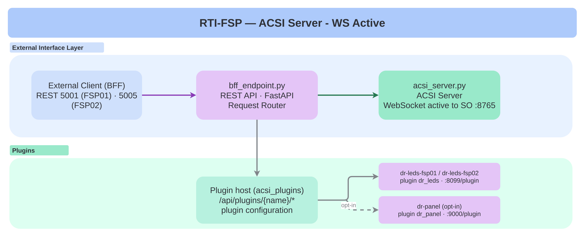

<!--
SPDX-FileCopyrightText: 2026 Netbeheer Nederland

SPDX-License-Identifier: Apache-2.0
-->

# FSP: IEC 61850 ACSI Server Implementation

This folder contains the **FSP (Functional Server Platform)** implementation - an **IEC 61850 ACSI Server** that provides WebSocket-based communication in active mode for substation automation and power system control.

## Overview

The FSP directory implements a complete **IEC 61850 ACSI (Abstract Communication Service Interface) Server** that:

- Exposes IEC 61850 data model via WebSocket (active mode)
- Provides REST API endpoints for server management (BFF - Backend for Frontend)
- Manages IED (Intelligent Electronic Device) models
- Handles read/write operations on data objects
- Supports dynamic model reloading
- Integrates with IO devices via the IO service (`examples/rti-plugins/dr_panel`, its own stack)

### Architecture



```
+------------------+     +---------------------+     +------------------+
|                  |     |                     |     |                  |
|   External       |<--->|   bff_endpoint.py   |<--->|   acsi_server.py  |
|   Client/API     |     |   (REST API)        |     |   (WebSocket)     |
|   (Port 5001)    |     |   FastAPI           |     |   IEC 61850 Server|
|                  |     |                     |     |   (Active Mode)   |
+------------------+     +----------+----------+     +----------+----------+
                                    |                        |
                                    v                        v
                            +--------------------+    +-------------------+
                            |   model.py         |    |   plugins          |
                            |   (IED Model)      |    |   (acsi_plugins)   |
                            +--------------------+    +-------------------+
```

### Directory Structure

```
modules/fsp/
├── pyproject.toml
├── docker/Dockerfile                   # Multi-stage build, port 5001 exposed
├── tests/
├── src/fsp/
│   ├── acsi_server.py                  # Core IEC 61850 WebSocket Server implementation (active mode)
│   │                                    # - ACSIServerRuntime: Runtime state management
│   │                                    # - ACSIServer: Main server controller
│   │                                    # - WebSocket connection management
│   │                                    # - Model loading and caching
│   │
│   ├── bff_endpoint.py                 # REST API (FastAPI) for server management
│   │                                    # - Server lifecycle control (start/stop)
│   │                                    # - Model operations (read/write/update)
│   │                                    # - Connection management
│   │                                    # - Action/message logging
│   │                                    # - IO plugin integration
│   │
│   └── model.py                        # Default/fallback IED model in Python format
│                                        # - Contains DataAttributes, DataObjects
│                                        # - IEC 61850 data model definitions
│                                        # - The live demo instead mounts
│                                        #   config/models/model_N.py via MODEL_PATH
│
└── README.md                           # This file
```

## Key Components

### 1. acsi_server.py - IEC 61850 WebSocket Server (Active Mode)

The core server implementation that handles:

- **WebSocket connection lifecycle** (connect, disconnect, connection management)
- **IEC 61850 server instantiation** using ws61850 library
- **Model loading and caching** from `model.py`
- **Async event loop management** for concurrent operations
- **Runtime state tracking** (status, connections, errors)
- **Message logging** (received and sent messages)
- **Action tracking** for audit purposes

#### Key Classes

| Class | Purpose |
|-------|---------|
| `ACSIServerRuntime` | Manages server runtime state, connections, model, actions, messages |
| `ACSIServer` | Main server controller with WebSocket endpoint integration |

### 2. bff_endpoint.py - REST API (Backend for Frontend)

A **FastAPI** application that provides REST endpoints for managing the ACSI Server. Acts as a bridge between HTTP clients and the WebSocket-based IEC 61850 Server in active mode.

#### Key Features

- **Server lifecycle management** (start, stop, status)
- **Model operations** (read values, write values, update model)
- **Connection management** (list connections, status)
- **Message/action logging** (view, clear logs)
- **Plugins** (the IO plugin and others; decision 0021)
- **CORS support** for web-based clients
- **Pydantic validation** for request bodies

#### API Endpoint Categories

| Category | Endpoints | Purpose |
|----------|-----------|---------|
| **Status** | GET `/api/iec61850server/status` | Server status |
| | GET `/api/iec61850server/connections` | Connection info |
| **Model** | GET `/api/iec61850server/model` | Model descriptor |
| | POST `/api/iec61850server/update-iedmodel` | Update model |
| **Lifecycle** | POST `/api/iec61850server/start` | Connect to the SO (starts the server if needed) |
| | POST `/api/iec61850server/stop` | Disconnect; the server stays ready |
| **Operations** | POST `/api/iec61850server/readvalue` | Read value |
| | POST `/api/iec61850server/writevalue` | Write value |
| **Logging** | GET `/api/iec61850server/actions` | View actions |
| | POST `/api/iec61850server/actions/clear` | Clear actions |
| | GET `/api/iec61850server/messages` | View messages |
| | POST `/api/iec61850server/messages/clear` | Clear messages |
| **Plugins** | GET, POST `/api/plugins` | List plugins, with their definitions (URL, settings); install one |
| | PUT `/api/plugins/{name}` | Edit its URL or settings, until the FSP restarts (decision 0036) |
| | POST `/api/plugins/{name}/reload`, DELETE `/api/plugins/{name}` | Reload; remove |
| | `/api/plugins/{name}/*` | A plugin's own routes, e.g. `/api/plugins/dr_panel/leds` |

---

## Quick Start

### Prerequisites

- Python 3.13+
- Docker (optional, for containerized deployment)
- Required Python packages (see below)

### Option 1: Docker (Recommended)

#### Build and Run (from repository root)

The build context must be the repository root - this Dockerfile also
needs `src/ws61850` (the core library) and the shared uv workspace lock.

```bash
# Build the Docker image
docker build -t netbeheer-nederland/iec61850-websocket/rti-fsp -f examples/rti-demo/modules/fsp/docker/Dockerfile .

# Run the container
docker run --rm -p 5001:5001 netbeheer-nederland/iec61850-websocket/rti-fsp

# With custom network (for multi-container setup)
docker network create rti-network
docker run --rm -p 5001:5001 --network rti-network --name rti-fsp netbeheer-nederland/iec61850-websocket/rti-fsp
```

#### API Health Check

```bash
curl http://localhost:5001/api/iec61850server/status
```

### Option 2: Direct Python Execution (Without Docker)

#### Install Dependencies

From repository root - `fsp` is a member of the shared uv workspace
(alongside `ws61850`, `so` and `bff`):

```bash
uv sync --all-packages
```

#### Run FSP API

From repository root:

```bash
# Default port (5001)
uv run --package fsp python -m fsp.bff_endpoint

# Custom port (Linux/macOS/WSL/Git Bash)
PORT=5001 uv run --package fsp python -m fsp.bff_endpoint

# Custom port (Windows PowerShell)
$env:PORT="5001"
uv run --package fsp python -m fsp.bff_endpoint
```

#### Health Check

```bash
curl http://localhost:5001/api/iec61850server/status
```

---

## API Usage

The FSP provides a comprehensive REST API for managing the IEC 61850 server in active mode, including server lifecycle control, model operations, data read/write, logging, and plugins.

For complete API documentation with all endpoints, parameters, and examples, open the interactive OpenAPI docs that
FastAPI serves at `http://localhost:5001/docs` while the service runs.

---

## Plugins

The FSP connects to plugins: HTTP services, each linking ACSI to another integration, for example the IO server's
LEDs, displays, buttons and potentiometers. The FSP tells every plugin what happens (an association, an Operate, a write, a
stop), and the plugin that owns an objRef answers an Operate on it. No plugin is installed in
the FSP: it connects to the ones in its plugin configuration (`PLUGINS_FILE` or `PLUGINS`) at startup, and keeps
trying the ones it can't reach. How plugins work, and how to write one: [`modules/plugins/README.md`](../plugins/README.md)
and decisions [0021](../../../../docs/rti-demo/decisions/0021-acsi-plugin-host.md) and
[0029](../../../../docs/rti-demo/decisions/0029-plugins-are-http-services.md). The contract, as OpenAPI 3.1, is
[`modules/plugins/openapi.yaml`](../plugins/openapi.yaml); it also covers plugins' own routes, which this service's
`/docs` doesn't list.

### The IO plugin

The IO server ([`rti-plugins/dr_panel`](../../../rti-plugins/dr_panel/README.md)) is the FSP's IO plugin: compose
configures it in `config/plugin-configuration/io/rti-fsp01.json` (`http://dr-panel:9000/plugin`, with the overlay
`docker-compose.io.yaml`; by default each FSP connects to its own `dr_leds`), `launch.py` in `PLUGINS`
(`http://localhost:9000/plugin`). The first FSP gets the input devices' changes (the button, the potentiometers); the second FSP's configuration says
`"write_inputs": false`. Which devices react to which event or objRef is the IO server's
`io_mapping.json`; see the *Hardware demo* section of `examples/rti-demo/README.md`.

```bash
curl http://localhost:5001/api/plugins                     # connected plugins, health, and the ones not (yet) connected
curl http://localhost:5001/api/plugins/dr_panel/leds             # the IO server's /api/io/leds
curl -X PUT http://localhost:5001/api/plugins/dr_panel -H 'Content-Type: application/json' \
  -d '{"settings": {}}'                                       # edit its url or settings; a failed edit changes nothing
curl -X POST http://localhost:5001/api/plugins/dr_panel/reload   # ask it again what it is and start it again
```

---

## Configuration

### Environment Variables

| Variable | Default | Description |
|----------|---------|-------------|
| `PORT` | 5001 | REST API port |
| `CP` | cp1 | Communication point identifier |
| `FSP_AUTOSTART` | `true` | Start the ACSI server with the service, not connected (`ready`); `false` waits for `POST /api/iec61850server/start` (the HMI's Connect) |
| `FSP_AUTOCONNECT` | `false` | With `FSP_AUTOSTART`, also dial out to the SO at `FSP_SO_HOST:FSP_SO_PORT` |
| `FSP_SO_HOST` | `localhost` | The SO `FSP_AUTOCONNECT` dials; `rti-so` in the Docker stack |
| `FSP_SO_PORT` | 8765 | Its WebSocket port |
| `MODEL_PATH` | the package's own `model.py` | The IED model: a Python file (`config/models/model_1.py` in the Docker stack), or a folder with `model.py` |
| `PLUGINS_FILE` | none | The plugin configuration: `{"host_url": ..., "plugins": [{"name", "url", "settings"}]}` |
| `PLUGINS` | none | The same JSON inline; its plugins and `host_url` win over the file's |
| `PLUGIN_HOST_URL` | the configuration's `host_url` | Where plugins reach this service, for example to write input changes back |
| `PLUGIN_RETRY_SECONDS` | `10` | How often a configured plugin that isn't connected is tried again; `0`: never |
| `PLUGIN_ALLOWED_SOURCES` | `*` (any URL) | Comma-separated URLs that `POST /api/plugins` may add plugins from at runtime, and `PUT /api/plugins/{name}` may move one to. `*` stands for any host, any one part of it or any port (`http://192.168.0.*:8000`); `*` alone allows any URL, and set but empty allows none (decision [0037](../../../../docs/rti-demo/decisions/0037-plugin-allowed-sources-wildcards.md)) |

### Server Defaults

The FSP is the ACSI server and the WebSocket client (decision 0003): it dials out to the SO, it doesn't listen.
Starting the ACSI server and connecting it to the SO are two steps (decision 0033):

| Status | The ACSI server | Connected to the SO | HMI |
|---|---|---|---|
| `stopped` | not running: `writevalue` answers `server-not-running` | no | Stopped |
| `ready` | runs: serves its model, runs its reports, takes writes | no | Ready |
| `listening` | runs | dials out, tries again every few seconds until the SO is there | Serving |

- `FSP_AUTOSTART` (default on) makes it `ready` when the service starts; `FSP_AUTOCONNECT` (default off) makes it
  `listening`, to `FSP_SO_HOST:FSP_SO_PORT`.
- `POST /api/iec61850server/start` (the HMI's Connect) on a `ready` server only dials out; on a stopped one it starts
  and dials out, as before. With TLS or OAuth from the HMI, connect from there: `FSP_AUTOCONNECT` dials without them.
- `POST /api/iec61850server/stop` (the HMI's Disconnect) drops the connection and leaves the server `ready`; plugins
  get `ServerStopped` first. The server stops only with the service.

- **SO**: `localhost:8765` (`FSP_SO_HOST`, `FSP_SO_PORT`)
- **Mode**: `active`, the only one supported
- **CP**: cp1 (communication point)

---

## Troubleshooting

### Common Issues

| Issue | Solution |
|-------|----------|
| **Port 5001 in use** | Use different port: `PORT=5011 uv run --package fsp python -m fsp.bff_endpoint` |
| **Port 8765 in use** | Change WebSocket port in start request |
| **Docker not found** | Install Docker Desktop and ensure it's running |
| **Module not found** | Run `uv sync --all-packages` from repository root |
| **Server not starting** | Check logs, verify model.py exists and is valid |

### Debug Commands

```bash
# Check server status
curl http://localhost:5001/api/iec61850server/status

# Check connections
curl http://localhost:5001/api/iec61850server/connections

# View actions
curl http://localhost:5001/api/iec61850server/actions

# View messages
curl http://localhost:5001/api/iec61850server/messages
```

---

## Integration

### With the IO service

FSP integrates with the IO service to control physical IO devices through IEC 61850 objects.

**Flow**: Write to IEC 61850 object -> Mapped to IO device -> the IO service controls the physical device

### With SO (Client)

The FSP connects to the SO as a WebSocket client, and serves its model to it as the ACSI server:

```
FSP (ACSI server, WebSocket client) --dials--> SO (WebSocket server, port 8765; ACSI client)
FSP (BFF, Port 5001) <--HTTP--> External Clients
```

---

## Files Reference

| File | Purpose | Key Classes/Functions |
|------|---------|---------------------|
| `acsi_server.py` | WebSocket Server (active mode) | ACSIServerRuntime, ACSIServer |
| `bff_endpoint.py` | REST API | FastAPI app, endpoint routes |
| `model.py` | IED model | Generated data model |
| `docker/Dockerfile` | Container | Multi-stage build |

---

## License

Part of the **RTI_DEMO** project. See main project for licensing information.
