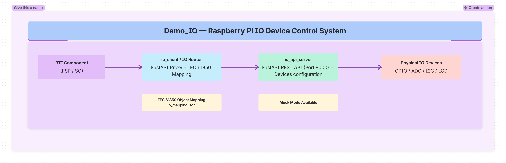

<!--
SPDX-FileCopyrightText: 2026 Netbeheer Nederland

SPDX-License-Identifier: Apache-2.0
-->

# IO: Raspberry Pi IO Device Control - WebSocket and ACSI Services Integration

This directory contains the **IO plugin** for Raspberry Pi, the package `rpi_io` (`src/rpi_io/`), with the layout of
every plugin (decision [0030](../../../docs/rti-demo/decisions/0030-plugin-project-layout.md)). `rpi_io.server` is the
**IO server**, a FastAPI-based REST API service for direct hardware control. `rpi_io.plugin` makes it the FSP's and
SO's **IO plugin**: it implements the plugin API under `/plugin`, and an FSP or SO connects to it from its plugin
configuration (decision
[0029](../../../docs/rti-demo/decisions/0029-plugins-are-http-services.md)); see
[The IO plugin](#the-io-plugin-plugin). It keeps devices and IEC 61850 objects in sync. The server runs on the
Raspberry Pi as its own stack, apart from the demo's (decision
[0028](../../../docs/rti-demo/decisions/0028-rti-plugins-folder.md)); see [Docker](#docker-its-own-stack).

## Overview

The IO service enables remote control and monitoring of physical IO devices (LEDs, potentiometers, buttons, LCD displays) through:

- **Direct REST API** via the IO server (`rpi_io`)
- **ACSI Integration** as a plugin of the FSP and SO (`/plugin`, `rpi_io/plugin.py`): their events light LEDs and
  write displays, and the input devices write back to them
- **IEC 61850 Object Mapping** to connect IO devices to power system data model objects

### Architecture



```
+------------------+     +---------------------+     +------------------+
|                  |     |                     |     |                  |
|   RTI component  +---->+   IO plugin router  +---->+   IO server       |
|                  |     |   (IO Router)       |     |                  |
|                  |     |                     |     |                  |
+------------------+     +---------------------+     +--------+---------+
                                            |                    |
                                            v                    v
                                    +--------------------------------------+
                                    |     Physical IO & Hardware Devices    |
                                    |       (all connected to the IO server)|
                                    +--------------------------------------+
```

## Directory Structure

```
examples/rti-plugins/rpi_io/
├── pyproject.toml, uv.lock   # standalone uv project rpi-io (not in the root workspace); script rpi-io
├── docker-compose.yaml       # its own stack: rpi-io, on the external network rti-network; runs anywhere
├── docker-compose.pi.yaml    # overlay: the Raspberry Pi's devices
├── docker/
│   ├── Dockerfile            # multi-stage build; context is this folder
│   └── Dockerfile.dockerignore
├── scripts/                  # Raspberry Pi: Docker setup, build user and groups, GPIO simulation
├── tests/                    # uv run --package fsp pytest examples/rti-plugins/rpi_io/tests -q
└── src/rpi_io/
    ├── server/               # the IO server: rpi-io, or python -m rpi_io.server.main
    │   ├── main.py           # Entry point - creates IOController + FastAPI app
    │   ├── io_controller.py  # Core IO device management (LEDs, pots, buttons, LCDs)
    │   ├── devices.py        # Device configuration classes and types
    │   ├── pins.py           # Which pins each device claims
    │   ├── api_endpoint.py   # FastAPI endpoints for device control; mounts the plugin
    │   ├── io_config.py      # Configuration loading/saving
    │   ├── io_config.json    # Default device configurations
    │   └── lcd_i2c_check.py  # Hardware check for the I2C LCD
    └── plugin/               # the IO plugin: the plugin API under /plugin (decision 0029)
        ├── plugin.py         # describe, start, stop, events, control
        ├── mapping.py        # io_mapping.json: devices <-> events and objRefs
        └── io_mapping.json   # Default mapping
```

---

## Component 1: the IO server (`rpi_io`) - IO Device Control API

A **FastAPI-based web service** that provides REST API endpoints for controlling physical IO devices connected to a Raspberry Pi or simulated devices for development.

### Key Features

| Feature | Description |
|---------|-------------|
| **Multi-Device Support** | LEDs (digital output), Potentiometers (analog input), Buttons (digital input), LCDs (16x2, I2C) |
| **Hardware Abstraction** | Clean separation between hardware drivers and API logic |
| **Mock Mode** | Works without Raspberry Pi hardware (Windows/macOS development) |
| **REST API** | Complete CRUD operations for all device types |
| **Swagger UI** | Interactive API documentation at `/docs` |
| **Thread-Safe** | Safe concurrent access to IO devices |
| **Plug-in Architecture** | Easy to add new device types |

### Supported Devices

| Device Type | Description | Direction | Configuration |
|-------------|-------------|-----------|---------------|
| **LED** | Digital output - on/off control | OUTPUT | GPIO pin, initial state |
| **Potentiometer** | Analog input via an MCP3008 (SPI) or ADS1115 (I2C) ADC | INPUT | `adc_type`, ADC channel (and SPI bus/device), min/max values |
| **Button** | Digital input with debounce | INPUT | GPIO pin, debounce time, pull-up |
| **LCD (HD44780)** | 16x2 character display | OUTPUT | GPIO pins (RS, E, D4-D7) |
| **LCD I2C** | LCD with I2C backpack (PCF8574) | OUTPUT | I2C address, pin mappings |

### API Endpoints

All endpoints are under the `/api/io/` prefix and provide device management, LED control, and system status functionality.

### Configuration via Environment Variables

| Variable | Default | Description |
|----------|---------|-------------|
| `PORT` | 9000 | Server port (the same for a direct run, `launch.py` and Docker) |
| `IO_CONFIG_FILE` | `src/rpi_io/server/io_config.json` | The device configuration the server reads and saves to. A file that doesn't exist yet is seeded from the shipped `io_config.json`. `launch.py` sets it to the git-ignored `examples/rti-demo/config/io_config.json`, so saves leave the shipped file unchanged |
| `IO_MAPPING_FILE` | `src/rpi_io/plugin/io_mapping.json` | Which devices the IO plugin uses for each event and objRef (see [The IO plugin](#the-io-plugin-plugin)); seeded from the shipped file the same way. `launch.py` sets it to the git-ignored `examples/rti-demo/config/io_mapping.json` |

Start the server with `uv run rpi-io` from `examples/rti-plugins/rpi_io`, or with `launch.py io`
in `examples/rti-demo`; the modules use relative imports, so they don't run as scripts. The first installs this project
in its own environment (`.venv` here, with the Raspberry Pi packages), the second runs it from `src/` in the repository's
(`uv sync --all-packages`), where devices whose hardware packages are missing stay unavailable.

### Hardware Requirements

For **physical hardware operation** (not mock mode):

- **Raspberry Pi** (any model with GPIO header)
- **LEDs**: 5mm standard, 220Ω-470Ω resistors
- **MCP3008 ADC** (SPI) for the potentiometers, as in the default `io_config.json`; an ADS1115 (I2C) also works with
  `"adc_type": "ads1115"`
- **Potentiometers**: 10kΩ recommended, up to 4 (MCP3008 channels 0-3)
- **Buttons**: momentary push buttons (latching is done in software)
- **LCD**: HD44780-compatible 16x2 display
- **I2C LCD Backpack**: PCF8574-based (address 0x27 or 0x3F)

---

## The IO plugin (`/plugin`)

The IO server implements the plugin API (`examples/rti-demo/modules/plugins/openapi.yaml`, tag *Plugin API*) in
`rpi_io/plugin/plugin.py`. An FSP or SO configures it as

```json
{"name": "io", "url": "http://rpi-io:9000/plugin", "settings": {}}
```

| Call | What the IO server does |
|---|---|
| `GET /plugin` | `{"name": "io", "api": 2, "claims": [], "routes": "/api/io"}`: the FSP's or SO's `/api/plugins/io/*` reaches this server's `/api/io/*` |
| `POST /plugin/start` | Remembers the host, and sends the input devices' changes (button, potentiometers) to its `host_url`, as `io_mapping.json` says (`writeValue` or `operate`). The most recent host gets them, unless its settings say `"write_inputs": false` |
| `POST /plugin/events` | Answers `202`, then shows the event on the devices `io_mapping.json` maps to its name (below), and sets the output devices mapped to a written objRef |
| `POST /plugin/control` | `204`: it claims no objRefs, so the FSP decides every Operate itself |
| `POST /plugin/stop` | Forgets the host; stops sending it input changes |
| `GET /plugin/attached` | What it attaches, for the HMI's Overview (decision [0025](../../../docs/rti-demo/decisions/0025-plugins-show-attached-devices-in-hmi.md)): this server, with its LEDs (as green indicators: it doesn't know their colour), buttons and potentiometers, `degraded` while some devices didn't come up; and each display, with the text the plugin last wrote to it |
| `GET /plugin/mappings` | The mapping in use, the hosts that started it, and where inputs go |

What each event does (the names are the plugin's own, mapped to devices in `io_mapping.json`):

| Event | From an FSP | From an SO |
|---|---|---|
| `Associated` | `connected` on, display "FSP Connected: ..." | `connected` blinks twice, display "Connected: ..." |
| `OperateReceived` | `oper_rcv` blinks | |
| `OperateResponse` | display `oper_send`: "Operation: SUCCESS" or "FAILED - <cause>" | `operate` blinks, display the objRef and value |
| `ValueWritten` | the objRef's output devices set, display `writeValue` | the same, `setpoint` blinks, display `setpoint` |
| `ValueRead` | | `read` blinks, display the value or the failure |
| `ReportReceived` | | `rc_rcv` blinks, display rptID and dataSet |
| `ServerStopped` (the FSP's Disconnect) | `stopped` off, display "Disconnected" | |

Text goes to every display mapped to the name (the HD44780 LCD and the I2C LCD). `IO_MAPPING_FILE` names the mapping
file (default: the shipped `src/rpi_io/plugin/io_mapping.json`); a file that doesn't exist yet is seeded from the shipped one.

### IEC 61850 Object Mapping

The system supports **mapping IO devices to IEC 61850 data objects** using the `io_mapping.json` configuration:

```json
{
  "leds": {
    "led1": {
      "device_name": "led1",
      "objRef": "connected",
      "direction": "output",
      "device_type": "led"
    }
  },
  "buttons": {
    "button1": {
      "device_name": "button1",
      "objRef": "LD0/LPHD.PwrUp.stVal",
      "direction": "input",
      "device_type": "button"
    }
  }
}
```

This mapping allows:
- **Automatic IEC 61850 integration** when devices change state
- **BFF endpoints** to expose IO device states as IEC 61850 objects
- **Client applications** to subscribe to IEC 61850 objects that control IO devices

---

## Configuration Files

### src/rpi_io/server/io_config.json

Defines all IO devices and their configurations:
- Device name, type, and identifier
- GPIO pins for digital devices
- ADC channels for analog devices
- I2C addresses for I2C devices
- Initial states and descriptions
- ACSI server integration settings
- IEC 61850 object mappings

### src/rpi_io/plugin/io_mapping.json

Defines mappings between IEC 61850 objects and IO devices:
- Which IO device corresponds to which IEC 61850 data object
- Object reference (objRef) for each device
- Direction (input/output)
- Device type for validation

---

## IEC 61850 Integration

The IO service integrates with IEC 61850 power system protocols through:

1. **Object Mapping**: Map IO devices to IEC 61850 data objects (LD, LN, DO, DA)
2. **BFF Endpoints**: Expose IO device states through ACSI's BFF
3. **ACSI Integration**: Connect IO devices to ACSI server for protocol-level control

## GPIO Pin Mapping

### Raspberry Pi 5 Pinout Diagram

```
       3V3  (1) [o] [o] (2)  5V
  GPIO2/SDA (3) [o] [o] (4)  5V
  GPIO3/SCL (5) [o] [o] (6)  GND
   GPIO4    (7) [o] [o] (8)  GPIO14 (TXD)
       GND  (9) [o] [o] (10) GPIO15 (RXD)
  GPIO17   (11) [o] [o] (12) GPIO18
  GPIO27   (13) [o] [o] (14) GND
  GPIO22   (15) [o] [o] (16) GPIO23
      3V3  (17) [o] [o] (18) GPIO24
  GPIO10   (19) [o] [o] (20) GND
   GPIO9   (21) [o] [o] (22) GPIO25
  GPIO11   (23) [o] [o] (24) GPIO8 (CE0)
       GND  (25) [o] [o] (26) GPIO7 (CE1)
 GPIO0/ID_SD(27) [o] [o] (28) GPIO1/ID_SC
   GPIO5   (29) [o] [o] (30) GND
   GPIO6   (31) [o] [o] (32) GPIO12
  GPIO13   (33) [o] [o] (34) GND
  GPIO19   (35) [o] [o] (36) GPIO16
  GPIO26   (37) [o] [o] (38) GPIO20
       GND  (39) [o] [o] (40) GPIO21
```

The default devices defined in `io_config.json` use the following GPIO configuration:

| Device Name | Device Type   | GPIO / Channel | Physical Pin | Direction | Description                        |
|-------------|---------------|----------------|--------------|-----------|------------------------------------|
| led1        | LED           | 17             | 11           | OUTPUT    | LED 1                              |
| led2        | LED           | 18             | 12           | OUTPUT    | LED 2                              |
| led3        | LED           | 22             | 15           | OUTPUT    | LED 3                              |
| button1     | Button        | 4              | 7            | INPUT     | Button (latching, pull-up)         |
| button2     | Button        | 23             | 16           | INPUT     | Button (latching, pull-up)         |
| button3     | Button        | 24             | 18           | INPUT     | Button (latching, pull-up)         |
| pot1-pot4   | Potentiometer | MCP3008 ch 0-3 | -            | INPUT     | SPI ADC, bus 0, device 0           |
| lcd1        | LCD 16x2      | Multiple       | Multiple     | OUTPUT    | HD44780 4-bit mode                 |
| lcd_i2c     | LCD I2C       | I2C 0x27       | 3, 5         | OUTPUT    | HD44780 with PCF8574 backpack      |

### Pins are configuration

Every pin is set in `io_config.json`: `gpio_pin` for LEDs, buttons and PWM; `gpio_rs`, `gpio_e`, `gpio_data`
(`gpio_rw`, `backlight_pin`) for the HD44780 LCD; `i2c_bus` and `i2c_address` for I2C devices; and for an MCP3008
potentiometer, `spi_bus` and `spi_device` (`/dev/spidev<bus>.<device>`; device 0 is CE0, 1 is CE1) and
`spi_speed_hz`. Moving a device or adding another one is an edit there, not a code change.

The server checks that no two devices use the same pin. Each device claims the GPIO pins it uses, including the bus
pins behind it: an SPI device takes SCLK, MOSI, MISO and its chip select; an I2C device takes SDA, SCL and its
address. Devices on one bus share the bus pins, and the channels of one ADC share its chip select or address. A
device whose pins are taken is refused: at startup it is logged and left out while the others load, and
`POST /api/io/devices/config` or `/config/update` answers `400` with the conflict.

Pins used by hardware this server doesn't drive go in `reserved_pins`, so no device is put on them. One example is
the ST7789V display of dr-st7789v, run on the same Pi with
`--rst-pin 27 --cs ce1`:

```json
"reserved_pins": [
  {"gpio": 25, "by": "ST7789V display DC"},
  {"gpio": 27, "by": "ST7789V display RST"},
  {"spi": "0.1", "by": "ST7789V display"}
]
```

An entry is `{"gpio": <BCM>}`, `{"spi": "<bus>.<device>"}` (its chip select, sharing the bus pins with this server's
SPI devices) or `{"i2c": "<bus>@<address>"}`, with `by` saying what uses it. Reserved pins win over devices: a device
on one is left out. Saving the configuration keeps them, and `/config/update` takes a new list as `reserved_pins`.

`GET /api/io/pins` shows every header pin (BCM and physical number) with what uses it, the SPI and I2C addresses in
use, and the free pins.

### LCD Pin Mapping (HD44780 4-bit mode)

| LCD Pin | Pin Name | Raspberry Pi GPIO | Physical Pin | Function                            |
|---------|----------|-------------------|--------------|-------------------------------------|
| 4       | RS       | 26                | 37           | Register Select (0=Command, 1=Data) |
| 5       | RW       | GND               | -            | Read/Write (GND = Write mode)       |
| 6       | E        | 19                | 35           | Enable (clock signal)               |
| 11      | D4       | 13                | 33           | Data Bit 4 (MSB)                    |
| 12      | D5       | 12                | 32           | Data Bit 5                          |
| 13      | D6       | 16                | 36           | Data Bit 6                          |
| 14      | D7       | 20                | 38           | Data Bit 7 (LSB)                    |

### Wiring Connections

**LEDs (Active High)**:
- LED1: GPIO 17 (Pin 11) -> LED anode -> Resistor (220-470Ω) -> GND
- LED2: GPIO 18 (Pin 12) -> LED anode -> Resistor (220-470Ω) -> GND
- LED3: GPIO 22 (Pin 15) -> LED anode -> Resistor (220-470Ω) -> GND

**Buttons** (pull-up enabled in software):
- BUTTON1: GPIO 4 (Pin 7) -> Button -> GND
- BUTTON2: GPIO 23 (Pin 16) -> Button -> GND
- BUTTON3: GPIO 24 (Pin 18) -> Button -> GND

**MCP3008 ADC (SPI) for the potentiometers**:
- MOSI: GPIO 10 (Pin 19) -> MCP3008 Pin 11 (DIN)
- MISO: GPIO 9 (Pin 21) -> MCP3008 Pin 12 (DOUT)
- CLK: GPIO 11 (Pin 23) -> MCP3008 Pin 13 (CLK)
- CS: GPIO 8 (Pin 24, CE0) -> MCP3008 Pin 10 (CS/SHDN)
- VDD and VREF: +3.3V -> MCP3008 Pins 16 and 15
- AGND and DGND: GND -> MCP3008 Pins 14 and 9
- Potentiometers 1-4: wiper -> MCP3008 Pins 1-4 (CH0-CH3); outer legs to +3.3V and GND

**LCD 16x2 (HD44780 Controller)**:
- RS (Register Select): GPIO 26 (Pin 37) -> LCD Pin 4
- RW (Read/Write): GND -> LCD Pin 5 (hardwired to write mode)
- E (Enable): GPIO 19 (Pin 35) -> LCD Pin 6
- D4: GPIO 13 (Pin 33) -> LCD Pin 11
- D5: GPIO 12 (Pin 32) -> LCD Pin 12
- D6: GPIO 16 (Pin 36) -> LCD Pin 13
- D7: GPIO 20 (Pin 38) -> LCD Pin 14
- VDD (+5V): +5V -> LCD Pin 2
- VSS (GND): GND -> LCD Pin 1
- V0 (Contrast): Adjustable via potentiometer -> LCD Pin 3
- Backlight: +5V -> LCD Pin 15, GND -> LCD Pin 16

---

## Troubleshooting

### Common Issues

| Issue                                  | Solution                                                                  |
|----------------------------------------|---------------------------------------------------------------------------|
| **Port already in use**                | Use different port: `PORT=8081 python -m rpi_io.server.main`                            |
| **gpiozero import error (Windows)**    | Normal - uses mock mode. Install gpiozero for Pi.                         |
| **GPIO permission denied (Linux)**     | Run with sudo or add user to gpio group                                   |
| **MCP3008 not detected**               | Check SPI wiring, enable SPI in raspi-config                              |
| **ADS1115 not detected**               | Check I2C wiring, enable I2C in raspi-config                              |
| **LEDs not responding**                | Verify wiring (resistor +, GND -), check GPIO numbering                   |
| **ACSI connection failed**             | Check `GET /api/plugins` on the FSP or SO (`failed` says why) and the plugin URL in its configuration                                   |
| **Docker: `/dev/spidev0.0` not found** | Enable SPI in raspi-config, or remove SPI devices from docker-compose.pi.yaml |
| **Docker: device passthrough errors**  | Verify device files exist on host, check device permissions               |

### Debug Commands

```bash
# Check if the IO server is running
curl http://localhost:9000/api/io/health

# Check that the FSP has the IO plugin loaded and healthy
curl http://localhost:5001/api/plugins
curl http://localhost:5001/api/plugins/io/health

# List all devices
curl http://localhost:9000/api/io/devices

# Get device state
curl http://localhost:9000/api/io/devices/led1

# Check I2C devices
sudo i2cdetect -y 1

# Check GPIO access
ls /dev/gpio*
```

### Enable I2C on Raspberry Pi

```bash
sudo raspi-config
# Navigate to: Interface Options -> I2C -> Enable
sudo reboot
```

### Enable SPI on Raspberry Pi

```bash
sudo raspi-config
# Navigate to: Interface Options -> SPI -> Enable
sudo reboot
```

### I2C LCD backpack (PCF8574)

Install the I2C tools (`i2cdetect`) once:

```bash
sudo apt update && sudo apt install -y i2c-tools
```

Check that the I2C bus is up and the backpack answers:

```bash
lsmod | grep i2c
ls /dev/i2c*
sudo i2cdetect -y 1
```

Most PCF8574 backpacks use address **0x27** or **0x3F**. Set the address in `src/rpi_io/io_config.json` as a
decimal number (`39` is 0x27, `63` is 0x3F):

```json
{
  "name": "lcd_i2c",
  "device_type": "lcd_i2c",
  "i2c_address": 39,
  "i2c_bus": 1
}
```

| Issue                               | Solution                                                                   |
|-------------------------------------|----------------------------------------------------------------------------|
| `i2cdetect` shows no devices        | Check the wiring and that I2C is enabled                                   |
| Address shows `UU`                  | Another driver claims the address; power-cycle the board                   |
| Wrong address (0x27 vs 0x3F)        | Try the other address in `io_config.json`                                  |
| Permission denied on `/dev/i2c-1`   | `sudo usermod -aG i2c $USER`, then reboot                                  |

Wiring:

| LCD backpack | Raspberry Pi                         |
|--------------|--------------------------------------|
| GND          | Pin 6 (GND)                          |
| VCC          | Pin 2 (5V) or Pin 1 (3.3V)           |
| SDA          | Pin 3 (GPIO 2, SDA)                  |
| SCL          | Pin 5 (GPIO 3, SCL)                  |

Check the backpack's documentation for whether it needs 5V or 3.3V.

### Docker: its own stack

`rpi-io` isn't in the demo's `docker-compose.yml`: it has its own here, and joins the same external network,
`rti-network`, where the FSPs and SO reach it as `http://rpi-io:9000/plugin`.

```bash
docker network create rti-network 2>/dev/null || true
cd examples/rti-plugins/rpi_io
docker compose up -d                                                      # anywhere (mock mode)
docker compose -f docker-compose.yaml -f docker-compose.pi.yaml up -d     # on the Raspberry Pi
```

`docker-compose.yaml` runs anywhere: devices without their hardware stay unavailable (mock mode).
`docker-compose.pi.yaml` adds the Pi's devices and the settings that only exist for them (`user`, `group_add`, `ipc`,
`security_opt`, `cap_add`). Set `COMPOSE_FILE=docker-compose.yaml:docker-compose.pi.yaml` in `.env` here to make it
persistent on the Pi.

### Configure Docker User for Hardware Access

The `rpi-io` container runs as a configurable user with access to GPIO, I2C, and SPI groups. By default, the Dockerfile uses standard Raspberry Pi OS values for the `pi` user:

- `pi` user: UID=1000, GID=1000
- `gpio` group: GID=986
- `i2c` group: GID=988
- `spi` group: GID=989

If your system has different values, you can configure them in three ways:

**Method 1: Auto-detect with username (Recommended)**
Just pass the username - the script detects all IDs automatically (run
from `examples/rti-plugins/rpi_io/`, so docker compose finds this
project's compose files in the current directory):
```bash
./scripts/set_docker_user.sh pi && docker compose -f docker-compose.yaml -f docker-compose.pi.yaml up --build
```
For a different user:
```bash
./scripts/set_docker_user.sh myuser && docker compose -f docker-compose.yaml -f docker-compose.pi.yaml up --build
```

**Method 2: Use .env file**
Copy `.env` to your working directory and uncomment/modify the values:
```bash
# Edit .env with your username and UID/GID values
PI_USER=pi
PI_UID=1000
PI_GID=1000
GPIO_GID=986
I2C_GID=988
SPI_GID=989
COMPOSE_FILE=docker-compose.yaml:docker-compose.pi.yaml
docker compose up --build
```

**Method 3: Direct environment variables**
```bash
PI_USER=pi PI_UID=$(id -u pi) PI_GID=$(id -g pi) \
GPIO_GID=$(getent group gpio | cut -d: -f3) \
I2C_GID=$(getent group i2c | cut -d: -f3) \
SPI_GID=$(getent group spi | cut -d: -f3) \
docker compose -f docker-compose.yaml -f docker-compose.pi.yaml up --build
```

### Docker: Device Passthrough Issues

When running the IO service in Docker on the Pi, `docker-compose.pi.yaml` adds device passthrough for GPIO, I2C, and SPI devices. If you encounter the error:

```
Error response from daemon: error gathering device information while adding custom device "/dev/spidev0.0": no such file or directory
```

This means the host system (Raspberry Pi) does not have the required device files. The `rpi-io` service in docker-compose.pi.yaml mounts the following devices by default:

- **GPIO**: `/dev/gpiochip0`, `/dev/gpiochip4`, `/dev/gpiochip10-13`
- **I2C**: `/dev/i2c-1`, `/dev/i2c-13`, `/dev/i2c-14`
- **SPI**: `/dev/spidev0.0`, `/dev/spidev0.1`

**Solutions:**

1. **Enable required interfaces** on Raspberry Pi:
   - For SPI: Enable SPI in `raspi-config` (Interface Options -> SPI -> Enable)
   - For I2C: Enable I2C in `raspi-config` (Interface Options -> I2C -> Enable)
   - Reboot after enabling: `sudo reboot`

2. **Remove unused device mappings** from `docker-compose.pi.yaml` if you don't need certain device types. Comment out or remove the corresponding lines under the `devices:` section for the `rpi-io` service.

3. **Verify device files exist** on the host:
   ```bash
   ls /dev/gpio* /dev/i2c* /dev/spidev* 2>/dev/null
   ```

4. **Check user permissions**: The container runs as user `pi` with group membership in `gpio`, `i2c`, and `spi`. Ensure your host user has access to these device files.

5. **Use mock mode for development**: If running on non-Raspberry Pi systems (Windows, macOS, or Raspberry Pi without hardware), use `docker-compose.yaml` without `docker-compose.pi.yaml` (see [Docker](#docker-its-own-stack)). The IO server will operate in mock mode.

---

## License

This project is part of the **RTI_DEMO** project. See the main project for licensing information.

---

## Support

For issues or questions:

1. Check the **Troubleshooting** section above
2. Review the **API Endpoints** documentation
3. Test with Swagger UI: `http://localhost:9000/docs`
4. Verify hardware connections
5. Check system logs for errors

---

